# Ulanzi D200 / D200H: Recovery and repair (RK Solution)

Step-by-step guide to bring back an Ulanzi D200 or D200H deck that is stuck on "Ulanzi Starting up". It reflashes the firmware on the Rockchip (RK) chip from a Windows PC, using RKDevTool.

## Symptoms this fixes

- The deck is stuck on "Ulanzi Starting up" and never reaches the normal screen.
- All keys are black and only the bottom-right key shows "Ulanzi Starting Up".
- The deck is not recognized by Ulanzi Studio, or Windows shows it only as a generic USB device.
- It broke right after a firmware update that did not finish properly.

This guide is for the "Starting up" fault on RK (Rockchip) based D200 and D200H. If your deck has a different problem (keys not triggering a game, profiles resetting, Linux support), the steps below will not help.

## Try these first

These are things other owners have reported working, mostly on Reddit. None of them are guaranteed, and none of them need you to open the deck.

- **Another USB-C cable, plugged straight into the PC.** Skip hubs and docks, and try a different port (on a desktop, one on the back of the case). Some people got the screen back by connecting a USB-C to USB-C cable to another device, such as a phone, then moved the deck back to the PC cable once it started.
- **Hold the four corner keys.** Unplug the deck, press and hold all four corner keys for about a minute, then plug it back in with Ulanzi Studio open.
- **Ulanzi's own update.bat.** Ulanzi support has sent users a firmware package with an `update.bat` for Windows. The deck must first reach the "Starting Up" state while connected to the PC, then you run the script and wait about 20 seconds. If it does not recover, the firmware can't be restored this way, and you can come back to this guide.

If none of that helps, continue below.

## What you need

- A Windows PC. The tools here are Windows only.
- A USB data cable (not a charge-only one).
- Tweezers.
- A small screwdriver to remove the back cover.
- The files from the Google Drive folder below.

**Warning:** this method means opening the device. That may void your warranty, and you do it at your own risk. If the deck is still under warranty, contact the seller or Ulanzi support first.

---

## Materials on Google Drive

All materials (**_MACOSX**, **Driver**, DriverAssistant v5.1.1, **RKDevTool** v3.19 for Windows) in one folder:

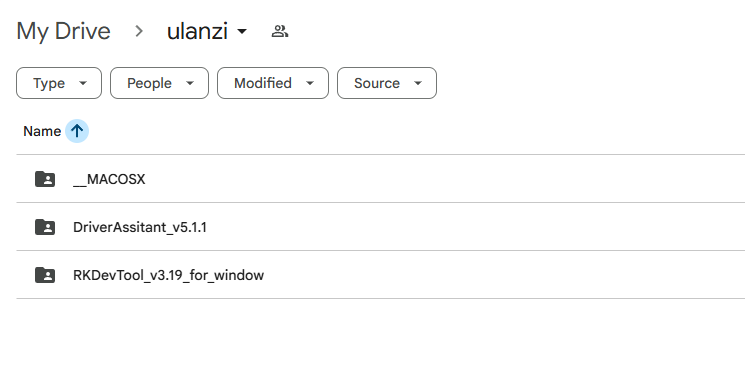

**[Open ulanzi folder](https://drive.google.com/drive/folders/1ayBERi3SmIFKS7yYgxk8DdpD99kiSG8D?usp=sharing)**

---

## Troubleshooting Steps for RK Solution-based D200 and D200H Models That Fail to Power On

**Applicable only to the fault where the device cannot enter the normal interface after "Ulanzi Starting up" appears at the bottom right corner during startup.**

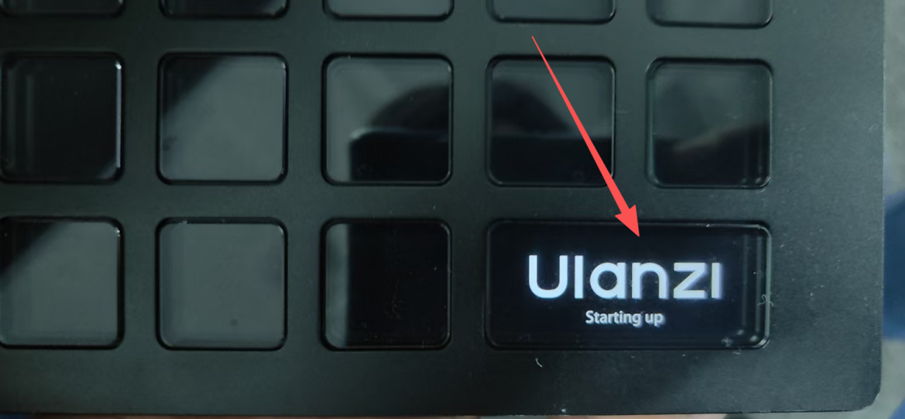

---

### Repair Tools and Steps

#### 1. Install the Windows version of the flashing driver: DriverAssitant_v5.1.1

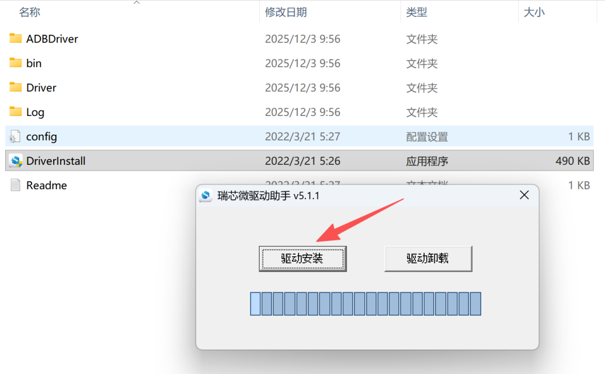

#### 2. Open the RKDevTool_v3.19_for_window flashing tool. Select "Upgrade Firmware", then choose the firmware file and import the "update" firmware into the tool.

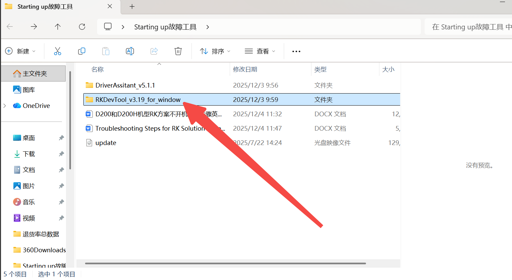

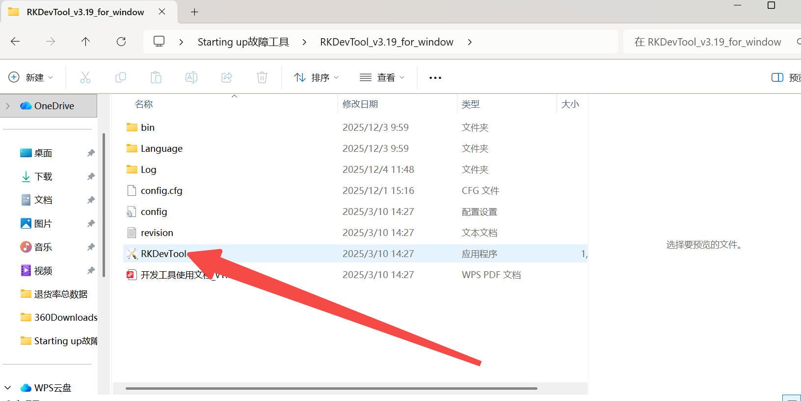

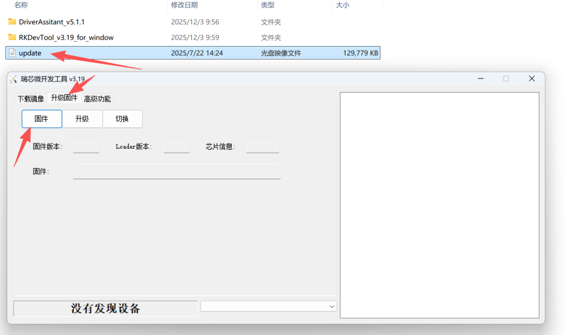

#### 3. Remove the device's back cover and use tweezers to short-circuit pins 1 and 3 as shown in the images.

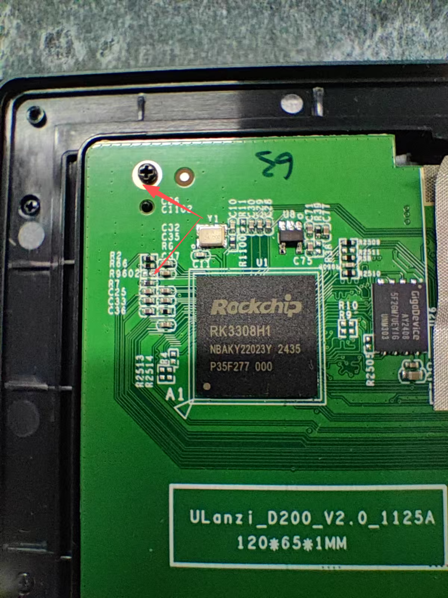

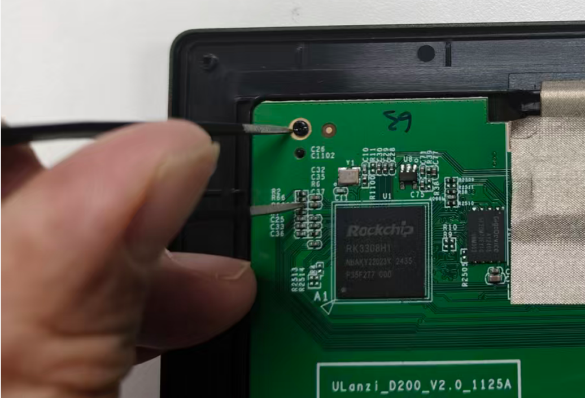

#### 4. Keep the short-circuit connected (don't let go of the tweezers) and plug in the USB cable to connect the PC and the device.

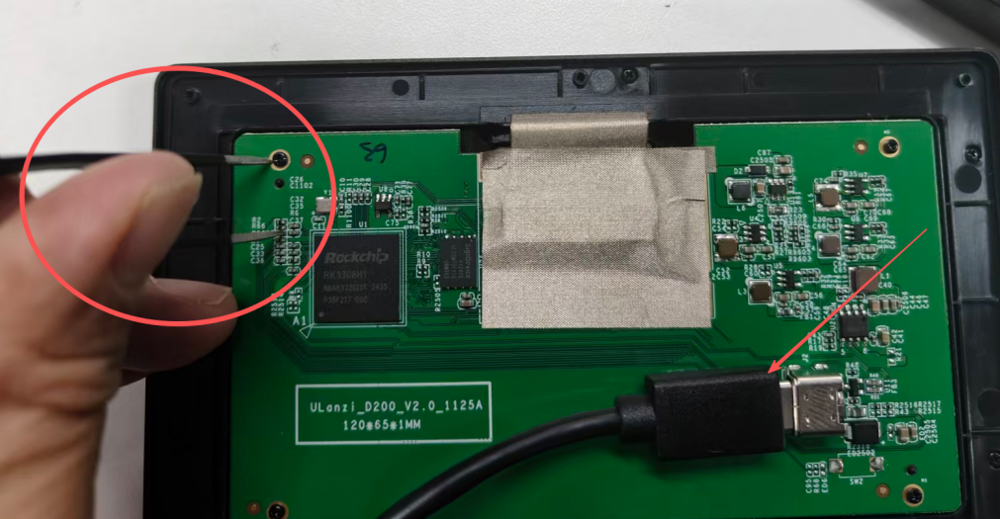

#### 5. If the PC tool shows "A LOADER device found", it means the device is successfully connected to the PC. You can then release the tweezers. If the connection fails, the tweezers may not be short-circuited properly. Please try repeatedly. Make sure to keep the short-circuit first, then plug in the USB cable.

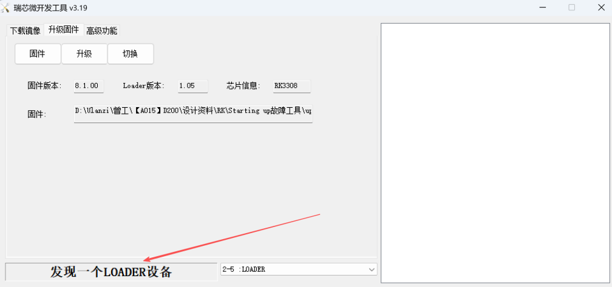

#### 6. Click "Upgrade" to start the firmware update. Wait until the download reaches 100% and the tool shows "Success". Then you can unplug the USB cable, plug it back in, and the fault will be resolved.

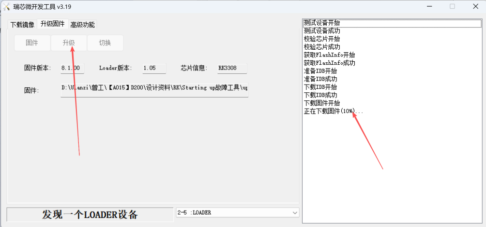

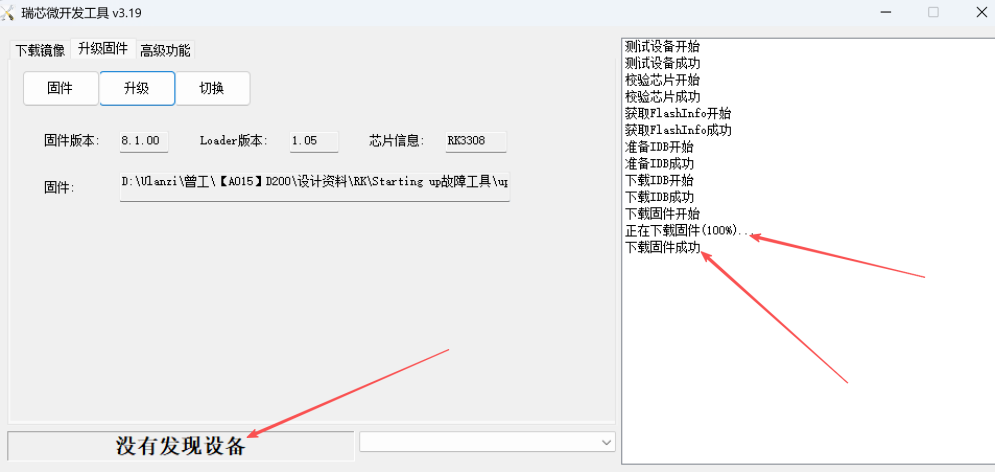

---

## Notes

- Install drivers via **DriverInstall.exe** from the DriverAssistant folder.
- RKDevTool documentation: the RKDevTool folder contains the PDF «开发工具使用文档_v1.0.pdf».
- Get the **update** firmware file from Google Drive (ulanzi folder) or from the official source.
- **Install path:** When installing or running the flashing tools and firmware, use a **simple, short path with no spaces or special characters** (e.g. `C:\ulanzi` or `D:\tools\RK`). Avoid paths like `C:\Users\Name\My Documents\...` or folders with spaces/symbols, or the tool may fail.

---

## If it didn't work

- **The tool never shows "A LOADER device found".** Check that the tweezers really touch pins 1 and 3, and that you hold the short before plugging in the USB cable. Try again a few times, then try a different cable and a different USB port.
- **The tool or driver misbehaves.** Make sure the driver is installed, and that the tools and firmware sit in a short path with no spaces, for example `C:\ulanzi`.
- **The deck is not detected at all** (no LOADER device, nothing new in Device Manager). The RK method may not apply to your unit. In that case contact Ulanzi support or the seller about a warranty replacement.
- **Still stuck.** Contact Ulanzi support or the seller, and tell them what you already tried.

---

## Did it work?

Please open an issue and say whether it worked or not. Include your model (D200 or D200H), what you tried, and what the tool showed. It helps the next person who lands here with the same screen.

If this saved your deck, a star helps others find it.
